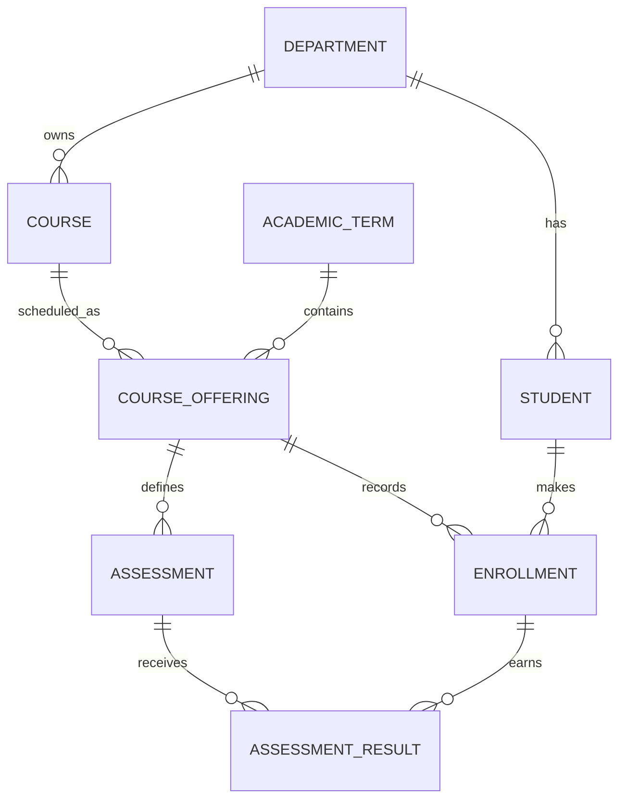

# Entity relationship model

The schema separates entities that have their own lifecycle and avoids copying course or student attributes into every registration/result row. `enrollment` resolves the many-to-many relationship between students and course offerings. The composite primary key on `assessment_result` ensures at most one recorded result per assessment and enrollment. The unique key on `(student_id, offering_id)` prevents duplicate registrations.

`seats_remaining` is a deliberately maintained counter so registration can claim capacity atomically under concurrency. Because it duplicates a value derivable from active enrolments, production code must update it only through the registration/drop transactions and run a reconciliation query. For the teaching seed, the stored capacities are chosen to agree with the illustrative records.

The grade thresholds in the view are examples only. MivaLearn is fictional; the actual institution's grading scale and policies must replace them before use with real records.
